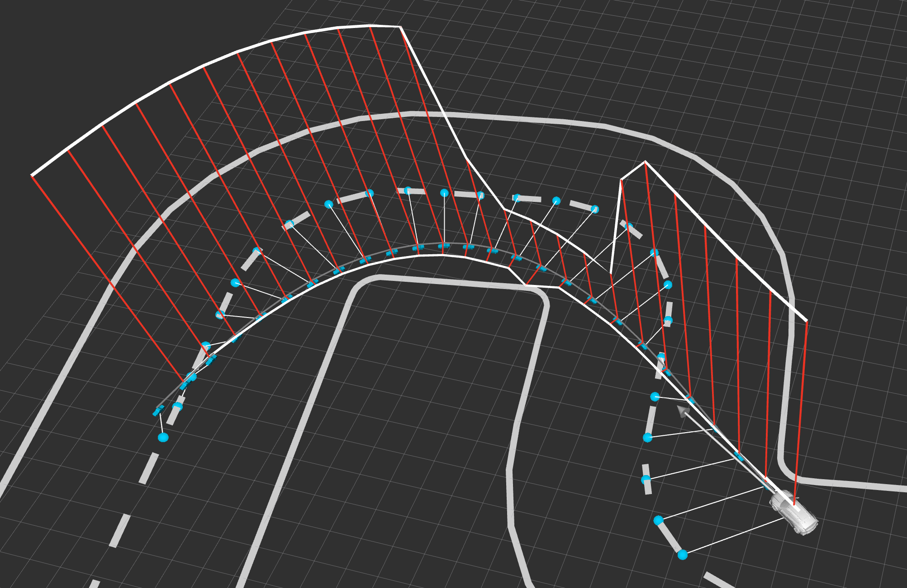
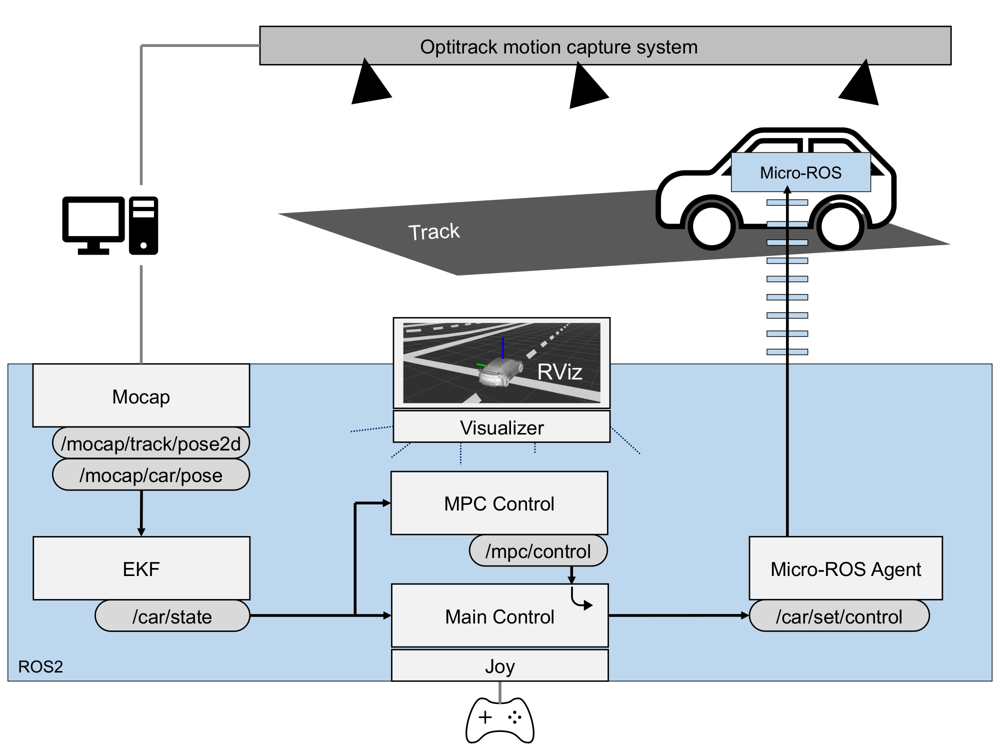
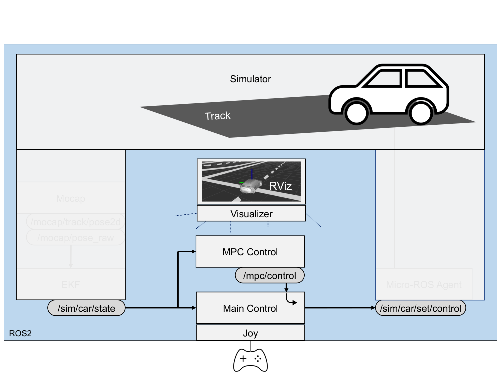

# Racing Control

[](LICENSE)
[-90e3dc.svg)](https://nccr-automation.ch/)

Real-time control of a mini race car, in simulation or on the real car.
This repository collects the ROS2 packages used to simulate, visualize, and control a small-scale autonomous race car, from low-level interfacing with the vehicle hardware up to model predictive control (MPC) for racing.

<p align="center">
  
</p>

The MPC controller showcased in the [publication below](#citing) is the `spline_following_tire_mpc_*` in the `mpc-control-racing-ros2/py` packages.


## Requirements

- [ROS 2](https://docs.ros.org/) (developed and tested with Humble)
- `colcon` and a C++ compiler with C++14 support
- Git submodules: clone with `git clone --recursive`, or run `git submodule update --init --recursive` afterwards

## Packages

| Package | Description |
|---|---|
| [la_racing_ros2](la_racing_ros2/README.md) | Interface to the real race car: onboard ESP32 firmware using micro-ROS, motion capture node, extended Kalman filter (EKF) state estimation, configuration and launch files. |
| [simulation-driving-ros2](simulation-driving-ros2/README.md) | Simulates the race car. |
| [visualization-driving-ros2](visualization-driving-ros2/README.md) | Visualizes either the simulated or the real race car and publishes to RViz. |
| [main-control-racing-ros2](main-control-racing-ros2/README.md) | Open-loop and closed-loop control for identification and path-following tasks. Forwards external MPC commands, if used. |
| [mpc-control-racing-ros2](mpc-control-racing-ros2/README.md)<br>[mpc-control-py-ros2](mpc-control-py-ros2/README.md) | Model predictive control (MPC) for racing, run as a separate node. `mpc-control-racing-ros2` is C++ based (ROS 2 C++), `mpc-control-py-ros2` is Python based (ROS 2 Python). |

Supporting packages:

| Package | Description |
|---|---|
| [utils-racing](utils-racing/README.md) | Race track description, race track and race line configuration files. |
| [lap-timer-ros2](lap-timer-ros2/README.md) | Detects when the race car crosses the finish line and measures the lap time precisely (hardcoded conditions for the L-shaped race track). |
| `mpc-msgs-racing-ros2` | Message definitions for `mpc-control-racing-ros2`. |

## System architecture

The nodes and their main topics, for the real car and for the simulation.

**Real car:**

<p align="center">
  
</p>

**Simulation:**

<p align="center">
  
</p>

## Model Predictive Control

There are two families of C++ MPC implementations (`mpc-control-racing-ros2`):

- **Automatic differentiation (AD) with Eigen**, solved with [laOPT](https://github.com/PREDICT-EPFL/laopt).
- **AD with CasADi**, solved with IPOPT or FATROP.

In addition, `mpc-control-py-ros2` provides Python implementations, including one based on [acados](https://docs.acados.org/).

The modeling frameworks and solvers used (such as laOPT, CasADi, acados, IPOPT, PIQP) are not part of this repository. If you use an optimizer, install the corresponding frameworks and solvers independently.

Each MPC optimizer is named with a letter code, for example `LAMP`:

| Letters | Meaning | Instances |
|---|---|---|
| 1st and 2nd | Modeling framework | `MO` = (CasADi) MX + Opti stack<br>`MA` = (CasADi) MX + ACADOS<br>`MR` = (CasADi) MX + Rockit<br>`LA` = laOPT |
| 3rd | Transcription | `M` = multiple shooting<br>`R` = Radau collocation |
| 4th | Solver | `I` = IPOPT<br>`P` = SQP with PIQP<br>`H` = SQP with HPIPM<br>`F` = FATROP |

Examples of MPCs compared in the paper:

- `MOMI`: (CasADi) MX + Opti stack, multiple shooting, IPOPT
- `MOMF`: (CasADi) MX + Opti stack, multiple shooting, FATROP
- `MAMH`: (CasADi) MX + ACADOS, multiple shooting, SQP with HPIPM
- `LAMP`: laOPT, multiple shooting, SQP with PIQP

The code is part of the executable names, for example `spline_following_mpc_LAMP_node2`.

| Package | Description |
|---|---|
| `mpc-control-racing-benchmark` | Benchmark comparison between several MPC solvers in closed-loop simulation with a simplified communication structure. |

## Credits

This project is developed by Johannes Waibel, Roland Schwan, and Colin N. Jones at the [Automatic Control Laboratory](https://www.epfl.ch/labs/la/) at [EPFL](https://www.epfl.ch/), Switzerland.

This work was supported by the Swiss National Science Foundation under the [NCCR Automation](https://nccr-automation.ch/) (grant agreement 51NF40_225155).

## Citing

If you use this code in scientific work, please cite the accompanying paper:

```bibtex
@INPROCEEDINGS{waibel2026laopt,
  author={Waibel, Johannes and Schwan, Roland and Jones, Colin N.},
  booktitle={2026 IEEE Conference on Control Technology and Applications (CCTA)},
  title={{laOPT}: A Native {C++} Optimal Control Toolbox for High-Performance Implementations, and Application to Racing},
  year={2026}
}
```

## License

BSD 2-Clause, see [LICENSE](LICENSE).
